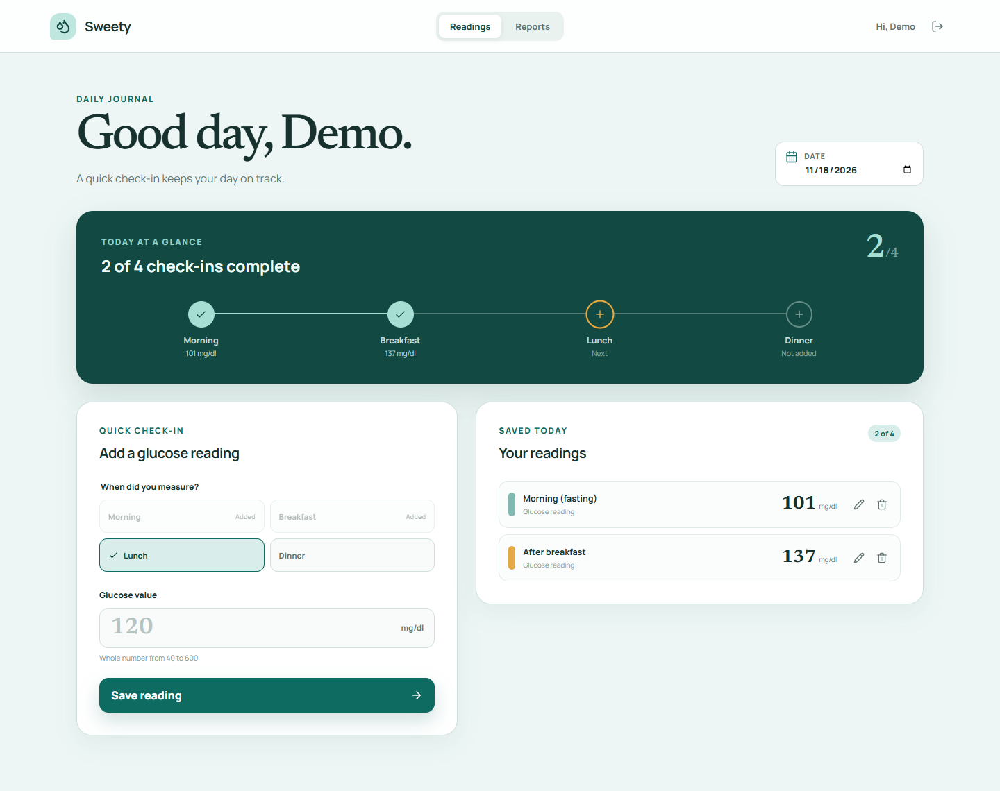
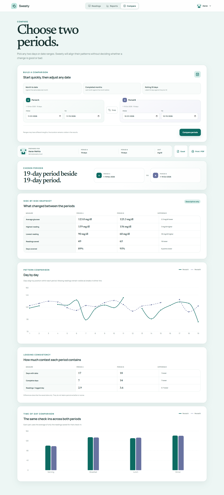
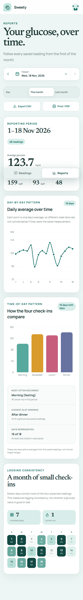

# Sweety

Sweety is a mobile-friendly blood glucose journal. It helps a patient record four daily check-ins, add useful context, review patterns, and compare any two periods without turning the data into medical advice.

## Demo recording

**Recording:** [Watch the 2–3 minute walkthrough](REPLACE_WITH_RECORDING_LINK)

## Screenshots

| Daily check-in | Reports |
|---|---|
|  |  |

| Custom comparison | Mobile view |
|---|---|
|  |  |

## What it includes

- Registration and login with bcrypt password hashing and JWT authentication.
- User-scoped create, edit, and delete operations for four daily reading slots.
- Clear validation for value, date, duplicate-slot, and four-per-day rules.
- Optional notes for meals, medicine, exercise, illness, or other context.
- Daily, month-to-date, and previous-month reports with averages and trends.
- A separate comparison workspace for any two days or date ranges.
- CSV and Excel exports, printable reports, paginated history, and responsive layouts.
- Backend integration tests and focused React tests.

## Run the project

You only need Docker Desktop with Docker Compose.

```bash
docker compose up --build
```

Then open [http://localhost:5173](http://localhost:5173).

The command starts PostgreSQL, creates the schema, adds the demo account and sample readings on the first run, and starts both the API and React client. Existing demo data is preserved on later restarts.

Demo login:

```text
Email: demo@sweety.local
Password: Sweety123!
```

No `.env` file is required for the Docker setup. [`.env.example`](.env.example) documents every available variable for local development or deployment. A real deployment should provide its own strong `JWT_SECRET`.

To stop the app:

```bash
docker compose down
```

PostgreSQL data remains in the Docker volume. Use `docker compose down -v` only when you intentionally want a fresh database.

## Run the tests

Requirements: Node.js 20 or later, npm, and the Docker database.

```bash
npm install
docker compose up -d db
npm test
```

The server tests use the separate `sweety_test` database. To check the production client bundle, run:

```bash
npm run build
```

## Project structure

```text
client/src/             React screens, components, charts, and API helpers
server/src/routes/      Express route definitions
server/src/controllers/ Request and response handling
server/src/services/    Validation, business rules, reports, and SQL
server/src/db/          PostgreSQL schema, migration, and demo seed
server/test/            API integration tests
docs/screenshots/       README and submission screenshots
```

The API follows `routes → controllers → services → PostgreSQL`. All SQL uses parameters, and every reading or report query is scoped to the authenticated user.

## Main tools

- React 19, Vite, Recharts, and React DayPicker
- Node.js, Express 5, and PostgreSQL
- bcrypt and JSON Web Tokens
- Node test runner, Supertest, Vitest, and React Testing Library
- Docker Compose

The assignment title mentions MERN and PostgreSQL. This project follows the assignment body and uses PostgreSQL instead of MongoDB.

## Notes

- Values must be whole numbers from 40 through 600 mg/dl.
- One reading is allowed per slot per day, with a maximum of four readings.
- Notes are optional and limited to 500 characters.
- Future-date validation uses `APP_TIME_ZONE`, which defaults to `Asia/Kolkata`.
- Missing days stay visible as gaps in charts instead of being silently connected.
- Comparisons describe the saved data but do not label one period as medically better or worse.

With more time, I would add password recovery, per-user time zones, edit history for health records, configurable clinician-reviewed target ranges, CI, and production monitoring.
